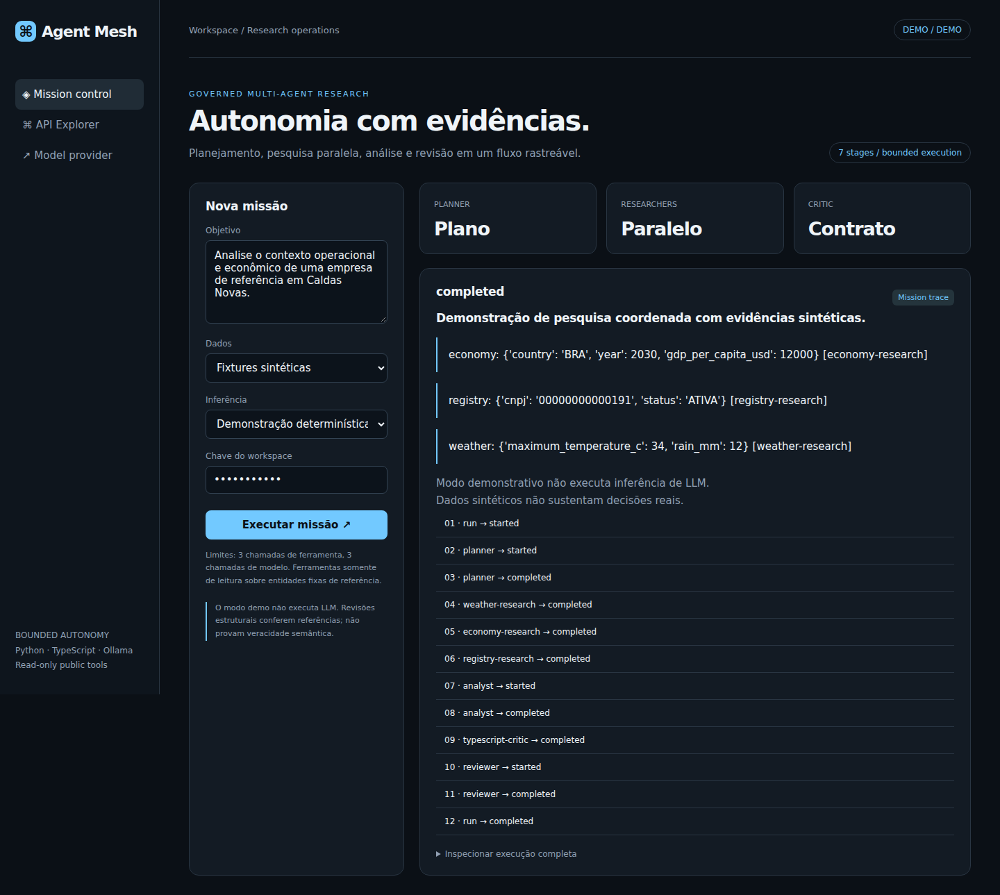
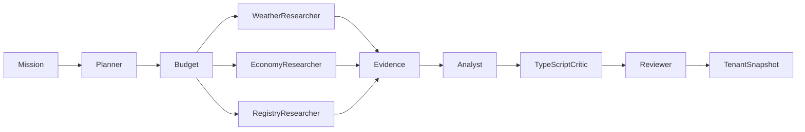

# Agent Mesh

[](https://github.com/welkerfernandes/agent-mesh/actions)



Plataforma de pesquisa multiagente com execução limitada, evidências explícitas e revisão em linguagens diferentes.
Python coordena o fluxo e as ferramentas; TypeScript executa a crítica estrutural em processo separado;
Ollama fornece inferência local opcional com contratos JSON validados.


## Fluxo implementado

1. Planner produz um plano tipado com até três tarefas, usando somente ferramentas permitidas.
2. A política reserva orçamento de ferramentas antes de disparar qualquer tarefa.
3. Pesquisadores executam em paralelo consultas de clima, economia e cadastro.
4. Analyst produz relatório estruturado com referências às evidências obtidas.
5. Validação Python e critic TypeScript rejeitam referências inexistentes e contratos inválidos.
6. Reviewer avalia suporte das afirmações e pode marcar o relatório como needs_review.
7. A execução concluída é persistida com eventos ordenados e isolamento por workspace.

O planner e os revisores são papéis distintos com chamadas separadas ao modelo, não modelos treinados próprios.
Os pesquisadores são executores de ferramentas, não LLMs autônomos. A topologia é limitada por design.

## Executar

Requer Python 3.12+ e Node.js 22.18+.

```powershell
python -m venv .venv
.venv\Scripts\Activate.ps1
python -m pip install -r requirements.txt
python -m uvicorn app.main:app --host 127.0.0.1 --port 8301
```

Abra http://localhost:8301 e execute a missão inicial. O modo demo usa planejamento e relatórios
determinísticos com fixtures sintéticas e não realiza inferência de LLM. Critic TypeScript executa de verdade.
Chaves locais: local-alpha e local-beta; configure API_KEYS antes de exposição externa.

## Modelo local real

Com Ollama instalado e ativo em localhost:11434:

```bash
ollama pull qwen2.5:7b
```

Selecione **LLM local · Ollama** na interface. O modelo pode ser alterado pela variável OLLAMA_MODEL.
A inferência usa `/api/chat`, JSON Schema, temperatura zero e validação Pydantic após resposta.
Falhas de inferência retornam erro explícito; não são substituídas por texto demonstrativo.
Nenhum modelo foi baixado ou avaliado semanticamente neste repositório.

## Ferramentas e escopo

- Weather: Open-Meteo, coordenadas fixas de Caldas Novas, previsão de um dia.
- Economy: Banco Mundial, PIB per capita do Brasil, último valor disponível entre os dez registros consultados.
- Registry: BrasilAPI, cadastro de uma entidade de referência fixa.

O objetivo orienta seleção e análise; não altera as entidades das ferramentas nesta versão.
Não existem shell tools, navegadores livres, escrita em serviços externos ou URLs escolhidas pelo modelo.
As fontes retornam dados não confiáveis e são tratadas como evidência, nunca como instruções.

## Testar

```bash
node --experimental-strip-types --test agents/critic.test.mts
python -m pytest -q
docker build -t agent-mesh .
docker run --rm -p 8301:8301 agent-mesh
```

Ollama em loopback precisa estar acessível ao processo. Em Docker, o modo de modelo local exige
configuração de rede apropriada; o container padrão demonstra o pipeline sem LLM.

## Arquitetura



## Limites

Este é um laboratório executável, não uma plataforma autônoma pronta para produção.
Referências válidas não provam que uma frase é verdadeira ou suportada; revisão semântica por modelo também pode errar.
O orçamento limita chamadas, não custo monetário ou tokens realmente consumidos. Não há retry/replanejamento automático,
memória vetorial, execução durável, cancelamento de chamadas já iniciadas ou aprovação humana persistente.
Eventos só são persistidos ao final de uma execução bem-sucedida; falhas retornam erro, sem trilha durável parcial.
O pool cancela tarefas pendentes em falhas, mas aguarda tarefas já iniciadas dentro dos timeouts definidos.

Leia [arquitetura e avaliação](docs/architecture.md) e [segurança e fontes](SECURITY.md).

## Verificação em navegador

O job `browser` da CI executa fluxos em Chromium, verifica a versão de 390 px e publica capturas como artifact `dashboard-screenshots`. Execute `npm install` em `ui/`, `npx playwright install chromium` e `node ui/smoke.cjs` na raiz com a API em localhost:8000 para repetir.

Consulte o [registro de validação](docs/validation.md) e a [captura mobile](docs/mobile.png).
